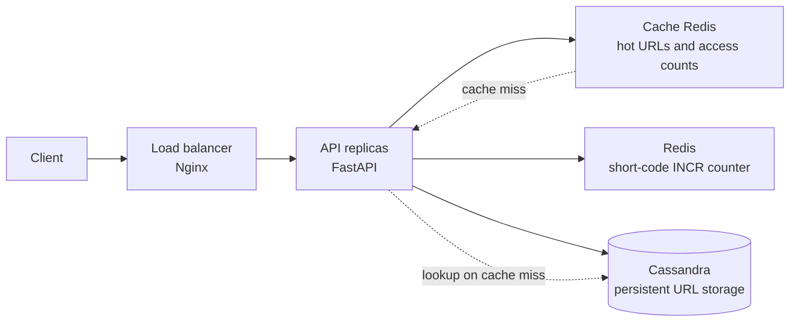

# URL Shortner

The API stores URL shorteners in Apache Cassandra using ScyllaDB's
Python driver (`scylla-driver`), which also supports Apache Cassandra.

## Architecture



The load balancer distributes requests across API replicas. The API checks the
cache Redis for short-code lookups and falls back to Cassandra on a cache miss;
the separate counter Redis generates short codes atomically with `INCR`, while
Cassandra remains the source of persistent URL data.

The code is divided by responsibility:

- `src/domain` contains the URL shortener entity and abstract repository and
  short-code generation contracts.
- `src/application/dtos` contains the application request and response DTOs.
- `src/application/commands` and `src/application/queries` implement CQRS:
  the create command and its handler are separate from read queries and
  their handlers, without depending on Cassandra, Redis, or Hashids.
- `src/application/controller` contains the FastAPI class-based controller,
  dependency adapters, and API routes.
- `src/application/handlers.py` assembles the CQRS handlers using domain
  contracts, without knowing about the concrete infrastructure adapters.
- `src/infrastructure` implements persistence with Cassandra, short-code
  generation with Redis and Hashids, and URL caching with a separate Redis
  instance. `EnvSettings` validates environment variables and the optional
  `.env` file using Pydantic Settings.
- `src/infrastructure/lifespan.py` manages infrastructure startup and shutdown
  and connects the adapters to the application handlers.

`src/main.py` is the API entry point: it configures FastAPI and its routes,
delegating resource lifecycle management to the infrastructure layer.

## Run with Docker Compose

Start Cassandra 5.0.9, Redis, two API instances, and Nginx as the load
balancer:

In PowerShell, generate and save a local key in `.env` (ignored by Git)
before starting Compose:

```powershell
[IO.File]::WriteAllText(
  "$PWD\.env",
  "SHORT_CODE_SECRET_KEY=$([Convert]::ToBase64String([Security.Cryptography.RandomNumberGenerator]::GetBytes(32)))",
  [Text.UTF8Encoding]::new($false)
)
docker compose up --build
```

Compose waits for Cassandra and both Redis services to become healthy, creates
the `url_shortner` keyspace, and then starts the API instances behind the Nginx
load balancer. The primary Redis service stores the short-code counter; the
separate `url-cache-redis` service stores the cache and temporary access counts.
To change the number of instances, for example to three, run:

```powershell
docker compose up --build --scale api=3
```

Nginx automatically updates its service discovery as instances change. The
Redis counter is persisted in the `redis_data` volume; the cache Redis is
ephemeral and can be discarded without affecting code generation. Cassandra
data is stored in the `cassandra_data` volume. The API is available through
the load balancer at `http://localhost:8000` by default. If port 8000 is
already in use, set `API_PORT` to another port (for example, `API_PORT=8001`).

To stop the containers without deleting the data:

```bash
docker compose down
```

### Adding Cassandra nodes

The Compose file currently defines one Cassandra node. Do not increase it with
`docker compose up --scale cassandra=3`: the replicas would share the
`cassandra_data` volume and try to publish the same host port. Cassandra nodes
need separate services and separate data volumes.

For a three-node, single-datacenter development cluster:

1. Keep the existing `cassandra` service as the first node, then add
   `cassandra-2` and `cassandra-3` services. Copy the existing Cassandra
   service settings, including its authentication entrypoint and healthcheck.
   Give each added node its own named volume, for example
   `cassandra_2_data:/var/lib/cassandra` and
   `cassandra_3_data:/var/lib/cassandra`, and declare those volumes at the end
   of the Compose file. Never mount the same Cassandra data volume into
   multiple nodes.

   For example, the topology-specific part of a second service is:

   ```yaml
   cassandra-2:
     image: cassandra:5.0.9
     environment:
       CASSANDRA_CLUSTER_NAME: url-shortner
       CASSANDRA_DC: datacenter1
       CASSANDRA_RACK: rack1
       CASSANDRA_ENDPOINT_SNITCH: GossipingPropertyFileSnitch
       CASSANDRA_SEEDS: cassandra,cassandra-2
     volumes:
       - cassandra_2_data:/var/lib/cassandra
   ```

   Copy the existing service's `entrypoint`, `command`, and `healthcheck` too;
   the example omits them for brevity. Add `cassandra_2_data:` to the top-level
   `volumes` section, and create a corresponding service and volume for each
   further node.
2. Set the same `CASSANDRA_CLUSTER_NAME`, `CASSANDRA_DC`, and
   `CASSANDRA_ENDPOINT_SNITCH` on every node. Set `CASSANDRA_RACK` to match
   the node's actual rack; containers on one development machine are not
   separate failure domains. Configure the same seed list on every node, for
   example `CASSANDRA_SEEDS: cassandra,cassandra-2`. Seeds help nodes discover
   the cluster; they do not determine data ownership.
3. Keep the existing host port mapping on only one node, or assign a different
   host port to each node if direct host access is needed. Nodes and the API
   can reach one another on port `9042` over Compose's internal network.
4. Change the API's `CASSANDRA_CONTACT_POINTS` to include multiple service
   names, for example `cassandra,cassandra-2,cassandra-3`. Update
   `cassandra-init` to wait for all intended nodes to become healthy before
   creating the keyspace.
5. For three nodes in `datacenter1`, create the keyspace with a replication
   factor of 3:

   ```sql
   CREATE KEYSPACE url_shortner
   WITH replication = {
       'class': 'NetworkTopologyStrategy',
       'datacenter1': 3
   };
   ```

   Use the actual `CASSANDRA_DC` value, and do not set the replication factor
   higher than the number of nodes in that datacenter. The current
   `cassandra-init` command uses `CREATE KEYSPACE IF NOT EXISTS` with
   `SimpleStrategy` and replication factor 1; update it for a new cluster.

Start the services and check that all nodes are `UN` (Up/Normal):

```powershell
docker compose up -d
docker compose exec cassandra nodetool status
```

When a new node joins with its own empty data volume, Cassandra automatically
assigns it token ranges and bootstraps the corresponding data. For an existing
keyspace, `CREATE KEYSPACE IF NOT EXISTS` does not change its replication
settings. Alter it explicitly, then run Cassandra repair on the nodes so
existing data is copied to the new replicas:

```sql
ALTER KEYSPACE url_shortner
WITH replication = {
    'class': 'NetworkTopologyStrategy',
    'datacenter1': 3
};
```

Because this Compose enables authentication, also configure `system_auth`
with `NetworkTopologyStrategy` and an appropriate replication factor, then
repair it as well. For the three-node example:

```sql
ALTER KEYSPACE system_auth
WITH replication = {
    'class': 'NetworkTopologyStrategy',
    'datacenter1': 3
};
```

Changing the replication settings does not itself copy existing data. Run
repair for both keyspaces on each node; for example:

```powershell
docker compose exec cassandra nodetool repair url_shortner
docker compose exec cassandra-2 nodetool repair url_shortner
docker compose exec cassandra-3 nodetool repair url_shortner
docker compose exec cassandra nodetool repair system_auth
docker compose exec cassandra-2 nodetool repair system_auth
docker compose exec cassandra-3 nodetool repair system_auth
```

Repair can use significant disk and network resources; plan it for the size
and load of the cluster.

Before removing a node, decommission it with `nodetool decommission` rather
than simply deleting its Compose service or volume. A multi-node Compose
cluster on one machine is useful for development, but does not provide
production fault isolation; production nodes should be distributed across
separate hosts and, where possible, racks or availability zones.

## Cassandra configuration

Create the keyspace before starting the API. For a single-node local Cassandra
instance, for example:

```sql
CREATE KEYSPACE url_shortner
WITH replication = {'class': 'SimpleStrategy', 'replication_factor': 1};
```

The application creates the `url_shortner` table on startup. Short codes are
generated using Redis's atomic `INCR` command and encoded with Hashids using
the Base62 alphabet. Set `SHORT_CODE_SECRET_KEY` to a value of at least 6
characters (use the same value across all instances and do not share it).
Hashids ensures codes are at least four characters long; it provides
obfuscation, not encryption. The Redis counter is initialized atomically to
`62³ - 1` (or left unchanged if it is already higher), so the first `INCR`
uses `62³`. Cassandra uses `IF NOT EXISTS` as an additional safeguard against
collisions with persisted codes. All API instances must use the same Redis
service; in Compose, the counter is persisted in the `redis_data` volume.
Outside Docker Compose, configure all the variables below in `.env` or in the
environment. There are no default values; the Cassandra username and password
can be empty when authentication is disabled:

| Variable | Requirement | Description |
| --- | --- | --- |
| `CASSANDRA_CONTACT_POINTS` | Required | Comma-separated Cassandra hosts |
| `CASSANDRA_PORT` | Required | Cassandra native transport port |
| `CASSANDRA_KEYSPACE` | Required | Existing keyspace |
| `CASSANDRA_USERNAME` | Required; Compose uses `admin` | Cassandra username; empty only when external Cassandra auth is disabled |
| `CASSANDRA_PASSWORD` | Required; Compose uses `admin` | Cassandra password; empty only when external Cassandra auth is disabled |
| `REDIS_URL` | Required | Redis connection URL |
| `URL_CACHE_REDIS_URL` | Required | Separate Redis connection URL for URL cache and access counts |
| `SHORT_CODE_SECRET_KEY` | Required | Hashids salt; use the same value across API instances |

Compose also requires `API_PORT` for the port published by the load balancer.
Copy `.env.example` to `.env` and set the secret key before starting the
environment. Short-code lookups are promoted to the cache after 5 accesses
within a 10-minute window and remain cached for 1 hour. Access counts are
shared across API replicas through the dedicated cache Redis service.

In Compose, Cassandra authentication is enabled, and the initialization
service creates the `admin` user with the password `admin`, granting access to
the `url_shortner` keyspace. These credentials are for local development only;
use a strong password and manage users and permissions appropriately in
production. The initial `cassandra/cassandra` user is used by the
initialization service to create the keyspace and configure the application
user.

`GET /api/url-shortner/` uses a full-table scan (`ALLOW FILTERING`) to preserve
the current list-all API. This is suitable for a small dataset; a large
production dataset should use a query-specific listing table and pagination.

## Tests

Run the unit tests, including application, domain, and infrastructure adapter
tests:

```powershell
.\.venv\Scripts\python.exe -m unittest discover -s tests
```

To validate the application with real Cassandra, both Redis services, two API
replicas, and Nginx through Docker Compose, run the end-to-end test (Docker
must be available, and local ports must be free):

```powershell
$env:RUN_DOCKER_INTEGRATION = "1"
.\.venv\Scripts\python.exe -m unittest discover -s tests\integration
Remove-Item Env:RUN_DOCKER_INTEGRATION
```

The test uses an isolated Compose project and volumes. It verifies requests
through the load balancer, URL creation and retrieval, promotion to the cache
Redis, and uniqueness and advancement of the `INCR` counter. On completion, it
removes the containers and volumes created for the test project.
