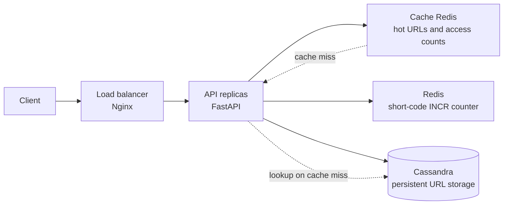

# URL Shortner

The API stores URL shorteners in Apache Cassandra using ScyllaDB's
Python driver (`scylla-driver`), which also supports Apache Cassandra.

## Architecture



The load balancer distributes requests across API replicas. The API checks the
cache Redis for short-code lookups and falls back to Cassandra on a cache miss;
the separate counter Redis generates short codes atomically with `INCR`, while
Cassandra remains the source of persistent URL data.

The code is divided by responsibility:

- `src/domain` contains the URL shortener entity and abstract repository and
  short-code generation contracts.
- `src/application/dtos` contains the application request and response DTOs.
- `src/application/commands` and `src/application/queries` implement CQRS:
  the create command and its handler are separate from read queries and
  their handlers, without depending on Cassandra, Redis, or Hashids.
- `src/application/controller` contains the FastAPI class-based controller,
  dependency adapters, and API routes.
- `src/application/handlers.py` assembles the CQRS handlers using domain
  contracts, without knowing about the concrete infrastructure adapters.
- `src/infrastructure` implements persistence with Cassandra, short-code
  generation with Redis and Hashids, and URL caching with a separate Redis
  instance. `EnvSettings` validates environment variables and the optional
  `.env` file using Pydantic Settings.
- `src/infrastructure/lifespan.py` manages infrastructure startup and shutdown
  and connects the adapters to the application handlers.

`src/main.py` is the API entry point: it configures FastAPI and its routes,
delegating resource lifecycle management to the infrastructure layer.

## Run with Docker Compose

Start Cassandra 5.0.9, Redis, two API instances, and Nginx as the load
balancer:

In PowerShell, generate and save a local key in `.env` (ignored by Git)
before starting Compose:

```powershell
[IO.File]::WriteAllText(
  "$PWD\.env",
  "SHORT_CODE_SECRET_KEY=$([Convert]::ToBase64String([Security.Cryptography.RandomNumberGenerator]::GetBytes(32)))",
  [Text.UTF8Encoding]::new($false)
)
docker compose up --build
```

Compose waits for Cassandra and both Redis services to become healthy, creates
the `url_shortner` keyspace, and then starts the API instances behind the Nginx
load balancer. The primary Redis service stores the short-code counter; the
separate `url-cache-redis` service stores the cache and temporary access counts.
To change the number of instances, for example to three, run:

```powershell
docker compose up --build --scale api=3
```

Nginx automatically updates its service discovery as instances change. The
Redis counter is persisted in the `redis_data` volume; the cache Redis is
ephemeral and can be discarded without affecting code generation. Cassandra
data is stored in the `cassandra_data` volume. The API is available through
the load balancer at `http://localhost:8000` by default. If port 8000 is
already in use, set `API_PORT` to another port (for example, `API_PORT=8001`).

To stop the containers without deleting the data:

```bash
docker compose down
```

## Cassandra configuration

Create the keyspace before starting the API. For a single-node local Cassandra
instance, for example:

```sql
CREATE KEYSPACE url_shortner
WITH replication = {'class': 'SimpleStrategy', 'replication_factor': 1};
```

The application creates the `url_shortner` table on startup. Short codes are
generated using Redis's atomic `INCR` command and encoded with Hashids using
the Base62 alphabet. Set `SHORT_CODE_SECRET_KEY` to a value of at least 6
characters (use the same value across all instances and do not share it).
Hashids ensures codes are at least four characters long; it provides
obfuscation, not encryption. The Redis counter is initialized atomically to
`62³ - 1` (or left unchanged if it is already higher), so the first `INCR`
uses `62³`. Cassandra uses `IF NOT EXISTS` as an additional safeguard against
collisions with persisted codes. All API instances must use the same Redis
service; in Compose, the counter is persisted in the `redis_data` volume.
Outside Docker Compose, configure all the variables below in `.env` or in the
environment. There are no default values; the Cassandra username and password
can be empty when authentication is disabled:

| Variable | Requirement | Description |
| --- | --- | --- |
| `CASSANDRA_CONTACT_POINTS` | Required | Comma-separated Cassandra hosts |
| `CASSANDRA_PORT` | Required | Cassandra native transport port |
| `CASSANDRA_KEYSPACE` | Required | Existing keyspace |
| `CASSANDRA_USERNAME` | Required; Compose uses `admin` | Cassandra username; empty only when external Cassandra auth is disabled |
| `CASSANDRA_PASSWORD` | Required; Compose uses `admin` | Cassandra password; empty only when external Cassandra auth is disabled |
| `REDIS_URL` | Required | Redis connection URL |
| `URL_CACHE_REDIS_URL` | Required | Separate Redis connection URL for URL cache and access counts |
| `SHORT_CODE_SECRET_KEY` | Required | Hashids salt; use the same value across API instances |

Compose also requires `API_PORT` for the port published by the load balancer.
Copy `.env.example` to `.env` and set the secret key before starting the
environment. Short-code lookups are promoted to the cache after 5 accesses
within a 10-minute window and remain cached for 1 hour. Access counts are
shared across API replicas through the dedicated cache Redis service.

In Compose, Cassandra authentication is enabled, and the initialization
service creates the `admin` user with the password `admin`, granting access to
the `url_shortner` keyspace. These credentials are for local development only;
use a strong password and manage users and permissions appropriately in
production. The initial `cassandra/cassandra` user is used by the
initialization service to create the keyspace and configure the application
user.

`GET /api/url-shortner/` uses a full-table scan (`ALLOW FILTERING`) to preserve
the current list-all API. This is suitable for a small dataset; a large
production dataset should use a query-specific listing table and pagination.

## Tests

Run the unit tests, including application, domain, and infrastructure adapter
tests:

```powershell
.\.venv\Scripts\python.exe -m unittest discover -s tests
```

To validate the application with real Cassandra, both Redis services, two API
replicas, and Nginx through Docker Compose, run the end-to-end test (Docker
must be available, and local ports must be free):

```powershell
$env:RUN_DOCKER_INTEGRATION = "1"
.\.venv\Scripts\python.exe -m unittest discover -s tests\integration
Remove-Item Env:RUN_DOCKER_INTEGRATION
```

The test uses an isolated Compose project and volumes. It verifies requests
through the load balancer, URL creation and retrieval, promotion to the cache
Redis, and uniqueness and advancement of the `INCR` counter. On completion, it
removes the containers and volumes created for the test project.
