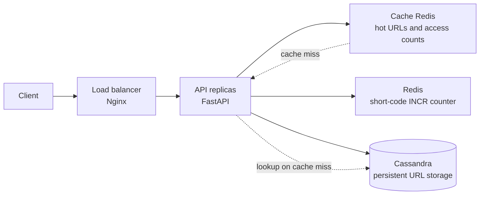

# URL Shortner

The API stores URL shorteners in Apache Cassandra using ScyllaDB's
Python driver (`scylla-driver`), which also supports Apache Cassandra.

## Architecture



The load balancer distributes requests across API replicas. The API checks the
cache Redis for short-code lookups and falls back to Cassandra on a cache miss;
the separate counter Redis generates short codes atomically with `INCR`, while
Cassandra remains the source of persistent URL data.

The code is divided by responsibility:

- `src/domain` contains the URL shortener entity and abstract repository and
  short-code generation contracts.
- `src/application/dtos` contains the application request and response DTOs.
- `src/application/commands` and `src/application/queries` implement CQRS:
  the create command and its handler are separate from read queries and
  their handlers, without depending on Cassandra, Redis, or Hashids.
- `src/application/controller` contains the FastAPI class-based controller,
  dependency adapters, and API routes.
- `src/application/handlers.py` assembles the CQRS handlers using domain
  contracts, without knowing about the concrete infrastructure adapters.
- `src/infrastructure` implements persistence with Cassandra, short-code
  generation with Redis and Hashids, and URL caching with a separate Redis
  instance. `EnvSettings` validates environment variables and the optional
  `.env` file using Pydantic Settings.
- `src/infrastructure/lifespan.py` manages infrastructure startup and shutdown
  and connects the adapters to the application handlers.

`src/main.py` is the API entry point: it configures FastAPI and its routes,
delegating resource lifecycle management to the infrastructure layer.

## Executar com Docker Compose

Suba o Cassandra 5.0.9, o Redis, duas instâncias da API e o Nginx como
balanceador de carga:

No PowerShell, gere e salve uma chave local no `.env` (ignorado pelo Git)
antes de subir o Compose:

```powershell
[IO.File]::WriteAllText(
  "$PWD\.env",
  "SHORT_CODE_SECRET_KEY=$([Convert]::ToBase64String([Security.Cryptography.RandomNumberGenerator]::GetBytes(32)))",
  [Text.UTF8Encoding]::new($false)
)
docker compose up --build
```

O Compose aguarda o Cassandra e os dois serviços Redis ficarem saudáveis, cria
o keyspace `url_shortner` e então inicia as instâncias da API atrás do
balanceador Nginx. O Redis principal mantém o contador de códigos; o serviço
`url-cache-redis` separado guarda o cache e as contagens temporárias de acessos.
Para alterar a quantidade de instâncias, por exemplo, para três, use:

```powershell
docker compose up --build --scale api=3
```

O Nginx atualiza a descoberta das instâncias automaticamente. O contador Redis
é persistido no volume `redis_data`; o Redis de cache é efêmero e pode ser
descartado sem afetar a geração dos códigos. Os dados do Cassandra ficam no
volume `cassandra_data`. A API fica disponível através do balanceador em
`http://localhost:8000` por padrão. Se a porta 8000 já estiver ocupada, defina
`API_PORT` para outra porta (por exemplo, `API_PORT=8001`).

Para encerrar os containers sem apagar os dados:

```bash
docker compose down
```

## Cassandra configuration

Create the keyspace before starting the API. For a single-node local Cassandra
instance, for example:

```sql
CREATE KEYSPACE url_shortner
WITH replication = {'class': 'SimpleStrategy', 'replication_factor': 1};
```

A aplicação cria a tabela `url_shortner` ao iniciar. Os códigos são gerados
por `INCR` atômico no Redis e codificados com Hashids usando alfabeto Base62.
Configure `SHORT_CODE_SECRET_KEY` com no mínimo 6 caracteres (guarde o mesmo
valor em todas as instâncias e não o compartilhe). Hashids garante códigos com
no mínimo quatro caracteres; é uma forma de ofuscação, não criptografia.
O contador Redis é inicializado atomicamente em
`62³ - 1` (ou mantido se já for maior), então o primeiro `INCR` usa `62³`.
O Cassandra usa
`IF NOT EXISTS` como proteção adicional contra colisões com códigos já
persistidos. Todas as instâncias da API devem apontar para o mesmo Redis; no
Compose, o contador fica persistido no volume `redis_data`. Fora do Docker
Compose, configure todas as variáveis abaixo no `.env` ou no ambiente. Não há
valores padrão; usuário e senha Cassandra podem ficar vazios quando a
autenticação estiver desabilitada:

| Variable | Requirement | Description |
| --- | --- | --- |
| `CASSANDRA_CONTACT_POINTS` | Required | Comma-separated Cassandra hosts |
| `CASSANDRA_PORT` | Required | Cassandra native transport port |
| `CASSANDRA_KEYSPACE` | Required | Existing keyspace |
| `CASSANDRA_USERNAME` | Required; Compose uses `admin` | Cassandra username; empty only when external Cassandra auth is disabled |
| `CASSANDRA_PASSWORD` | Required; Compose uses `admin` | Cassandra password; empty only when external Cassandra auth is disabled |
| `REDIS_URL` | Required | Redis connection URL |
| `URL_CACHE_REDIS_URL` | Required | Separate Redis connection URL for URL cache and access counts |
| `SHORT_CODE_SECRET_KEY` | Required | Hashids salt; use the same value across API instances |

O Compose também exige `API_PORT` para a porta publicada pelo balanceador. Copie
`.env.example` para `.env` e preencha a chave secreta antes de subir o ambiente.
As leituras por código curto são promovidas ao cache após 5 acessos em uma janela
de 10 minutos e permanecem em cache por 1 hora. As contagens são compartilhadas
entre as réplicas da API pelo Redis dedicado ao cache.
No Compose, o Cassandra habilita autenticação e a inicialização cria `admin`
com a senha `admin`, concedendo acesso ao keyspace `url_shortner`. Essas
credenciais são apenas para desenvolvimento local; use uma senha forte e
gerencie usuários/permissões adequadamente em produção. O usuário inicial
`cassandra/cassandra` é usado pelo serviço de inicialização para criar o
keyspace e configurar o usuário da aplicação.

`GET /api/url-shortner/` uses a full-table scan (`ALLOW FILTERING`) to preserve
the current list-all API. This is suitable for a small dataset; a large
production dataset should use a query-specific listing table and pagination.
